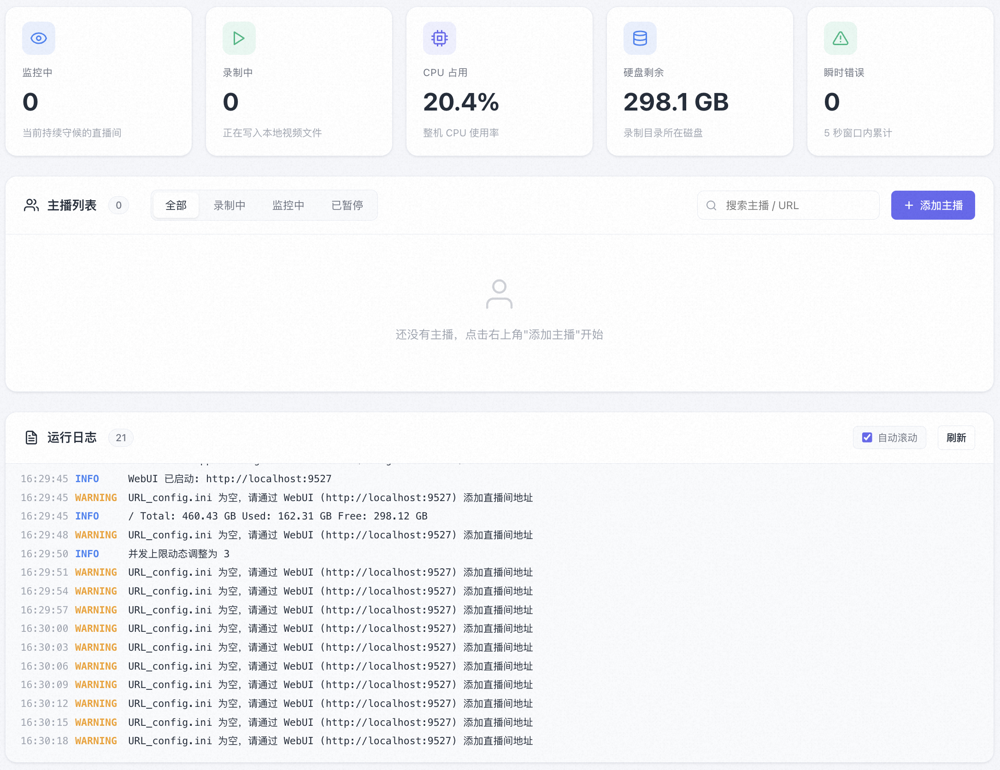

# DouyinLiveRecorder-UI

DouyinLiveRecorder-UI 是一个抖音和小红书直播录制工具：轮询主播是否开播，用 FFmpeg 录下直播流，并提供 Web UI 管理录制任务、状态和日志，还能同步录制抖音弹幕、按弹幕定位录像。基于 [ihmily/DouyinLiveRecorder](https://github.com/ihmily/DouyinLiveRecorder) 精简改造。



## 功能

- 抖音直播间；小红书 `livestream` 直链和 `xhslink.com` 分享短链。
- FFmpeg 录制，按坏流日志判定疑似花屏并快速重录。
- 记录每位主播上次直播结束时间；自动跟随抖音主播改名，同步监控列表、录制目录和文件名。
- 抖音可选同步录制聊天弹幕（JSON Lines），并提供弹幕检索和录像定位页面。
- 特别监控的主播开播时发出通知事件。

## 安装与运行

需要 FFmpeg（`apt install ffmpeg`；Windows 把 `ffmpeg.exe` 放进项目根目录的 `ffmpeg/`）。启动后 Web UI 在 <http://localhost:9527>，监听 0.0.0.0：

```console
$ uv sync
$ uv run main.py
```

## 本机部署

| 内容 | 位置 |
| --- | --- |
| 线上代码 | `/srv/apps/douyinlive-recorder/current` → `releases/<版本>` |
| 服务 | `douyinlive-status.service`（系统服务，不要前台跑 `main.py`） |
| 配置、日志、弹幕索引 | `/srv/apps/douyinlive-recorder/{config,logs,data}`，发布目录里的同名目录链接到这里 |
| 视频和弹幕原始文件 | `/srv/nas/Record` |
| 访问地址 | 外网 `dy` 子域（经 Authelia） |

```console
$ systemctl status douyinlive-status.service
$ journalctl -u douyinlive-status.service -n 100
```

本目录是源码，修改后要建发布副本、切换 `current` 再重启服务。**修改 Python 后端要重启服务，只刷新网页不会加载新逻辑**，挑不影响录制的时间重启。

## Web UI

- **顶部**：监控中、录制中、CPU 占用（每秒采样、EMA 平滑）、录制盘剩余空间、近期错误数。
- **主播列表**：按全部 / 录制中 / 监控中 / 已暂停 / ★ 特别监控筛选，可叠加“未开播至少 7 / 30 / 90 / 180 天”；按状态、未开播时长或名称排序；搜索主播或 URL；添加、暂停、恢复、删除。未录制的主播显示距上次直播的时长，悬停看结束时间和上次录制时长。
- **运行日志**：实时日志，可自动滚动或手动刷新。

添加主播时输入框预填 `https://live.douyin.com/`，补上房间号即可；粘贴完整的抖音或小红书链接会替换前缀。也可以直接在 `config/URL_config.ini` 里一行写一个地址：

```text
https://live.douyin.com/745964462470
https://v.douyin.com/iQFeBnt/
https://live.douyin.com/yall1102           (链接+抖音号)
https://v.douyin.com/CeiU5cbX              (主播主页)
https://www.xiaohongshu.com/livestream/570321613446566013
http://xhslink.com/xxxxxx                  (小红书分享短链)
```

小红书只能录**当前这一场**，不能从作者主页发现下一场；下次开播要重新添加新链接，也不支持弹幕。遇到登录限制时在 `config.ini` 的 `[Cookie]` 填 `小红书cookie`。

## 配置

录制和轮询策略在 `config/config.ini`，主播列表在 `config/URL_config.ini`，`backup_config/` 是定时备份。

- 录制统一请求原画/平台最高档，流不可用时按平台解析器回退。
- `config.ini` 变化后自动重读并完整校验，有错（数值、INI 格式、空文件）时保留上一份有效配置继续运行，修正后自动恢复；删除的配置项恢复默认值。**首次启动配置无效会直接拒绝启动**，避免误用默认录制目录。数字不要带单位，开关填 `是` / `否`。
- 网络请求并发上限、录制根目录、弹幕检索根目录在启动时绑定，改了要重启。
- 主播列表的增删改用同一把锁和“同目录临时文件 + 原子替换”写入，失败时保留原文件。手动编辑时用编辑器的原子保存；程序的锁管不到外部编辑器。
- `转码完成回调地址`：每段录像转完 MP4 后，向这个地址 POST `{"path": "<原文件绝对路径>"}`，失败重试 3 次后只记日志，不影响录制；留空不回调，开了 `追加格式后删除原文件` 时也不回调。本机填 `http://127.0.0.1:8791/file`，由 nas-ops 的录播归档接收，立即把原文件移到备份目录（见 `/root/workplace/nas-ops/README.md`）。
- `录制中文件放到TempRec子目录`：开启后录制中的 `.ts`、`.danmaku.jsonl`、`.segments.csv` 写在 `<平台目录>/TempRec/<主播>/`。每段转出的 MP4 先以 `.` 开头的临时文件写到 `<平台目录>/<主播>/`，写完再改成正式文件名；整场转完后，弹幕和分段清单也移过去。原始 `.ts` 留在 `TempRec`，等归档移走。这样做是因为 Jellyfin 内置忽略 `**/TempRec/**` 和隐藏文件；如果录制中的文件写在库目录里，持续写入会让 Jellyfin 一直推迟刷新，整个录播库都不会更新。目录名固定为 `TempRec`，开启时必须同时开启 `录制完成后自动转为mp4格式`，保存格式只能是 TS 或 FLV，否则配置校验不通过。没有转码的录像（比如异常结束的）会留在 `TempRec`。
- **重启服务会留下没转码的分段**：收到停止信号时进程直接退出，正在录的那一段只有 `.ts`，没有 `.mp4` 和回调，归档也不会移走它。重启后要手动补转码，在发布目录执行：`.venv/bin/python -B -c "import src.config_loader as c, src.recorder as r; r.converts_mp4('<ts 路径>', c.Settings('config/config.ini'))"`，转完会照常回调，MP4 会移出 `TempRec`。弹幕和分段清单再用 `r.publish_sidecars('<分段模板，如 .../主播_2026-10-17_19-15-37_%03d.ts>')` 移出。

### 花屏重录

| 配置项 | 默认 | 说明 |
| --- | --- | --- |
| `自动检测花屏并重录` | 开 | 读 FFmpeg 坏包/解码异常日志，命中阈值就中断重新拉流 |
| `花屏检测错误阈值` | 8 | 时间窗口内多少条异常日志触发重录 |
| `花屏检测时间窗口(秒)` | 20 | 滑动窗口 |
| `花屏重录冷却时间(秒)` | 3 | 触发后多久再录 |
| `花屏检测是否旁路解码验证` | 关 | 额外解码一路视频，捕获 `copy` 模式下看不到的错误 |

旁路解码每路约多占 1 核的 5～15%（1080p H.264），10 路并发可能多吃 1～2 核；CPU 长期超过 80% 时关掉它或降低 `最大同时录制数`。网络抖动导致误判多时，调高阈值或时间窗口。

### 断流与启动退避

- `断流首次快速重连时间(秒)`：断流后首次刷新间隔，默认 15。
- `连续断流退避上限(秒)`：连续断流按 15 → 30 → 60 → 120 秒逐级放慢并封顶，带 0～5 秒随机抖动。
- `连续抓取失败退避上限(秒)`：接口连续失败时最多放慢到 300 秒，避免触发风控。
- `稳定录制后重置退避时间(秒)`：连续录制这么久后清零断流计数，默认 300。
- 连续花屏重录单独按 3 → 10 → 30 → 120 秒退避；确认下播后恢复普通循环时间。
- 主播多时调大 `首次启动排队读取网址时间(秒)` 和 `首次启动随机抖动时间(秒)`，把启动时的请求打散。

## 开播通知

在主播列表点 **☆** 开启特别监控。开播检测生成通用 `live.started` 事件，由通知适配器发送；核心不绑定 QQ、微信或邮箱。目前的适配器是 QQ 抖音录制机器人（`nas-ops/plugins/qq-douyin-recorder-plugin`），只发到指定的已绑定群。

暂停的主播不提醒；重连不重复产生事件；星标和去重状态重启后保留。接口和接入方式见 [通用通知接口 v1](docs/notifications.md)。

## 弹幕录制

依赖 MIT 许可的 [jwwsjlm/douyinLive](https://github.com/jwwsjlm/douyinLive) 伴随服务，端口只发布到本机回环（本机用 `/srv/apps/douyinlive-danmaku/compose.yaml` 部署）：

```bash
docker run -d --name douyinlive-danmaku --restart unless-stopped \
  -p 127.0.0.1:1088:1088 \
  ghcr.io/jwwsjlm/douyinlive:v2.1.0
```

在 `config.ini` 的 `[录制设置]` 开启：

```ini
是否录制弹幕 = 是
弹幕服务地址 = ws://127.0.0.1:1088
```

- 每轮录制在视频同目录生成同基名的 `.danmaku.jsonl`：`name.flv → name.danmaku.jsonl`，分段模板 `name_%03d.ts → name.danmaku.jsonl`，同一轮所有分段共用一个文件。
- **JSONL 是原始记录，要长期保留**；XML 等格式都从它派生。
- 逐行写入并刷新，异常退出最多丢最后半行。伴随服务断线或解析失败只记日志并退避重连，不影响视频录制。文件以排他模式创建，同名文件已存在时放弃弹幕、继续录视频，不会截断原文件。

文件格式（schema v1）和转成 Bilibili XML 的方法见 [弹幕 JSONL 格式与转换](docs/danmaku.md)。

## 弹幕检索与录像定位

控制面板顶部点 **弹幕检索**，或访问 `http://服务器地址:9527/danmaku`。

- 按弹幕、主播、发言者/用户 ID 搜索；空格分隔多个关键词，可选任意或全部匹配。时间范围含边界、精确到毫秒，按浏览器本地时区。
- 首次访问自动建 SQLite 索引（`.cache/danmaku/index-v1.sqlite3`），之后 **刷新弹幕索引** 只处理新增或变化的文件；正在写入的不完整末行留到下次。停服务后可删缓存重建。命令行可用 `danmaku_search.py`。
- **定位视频** 显示录像路径和片内时间，可跳转、提前 5 秒回看、复制路径或下载；视频接口支持 HTTP Range。
- 启用弹幕和分段录制时，同目录会生成 `同基名.segments.csv`，记录 FFmpeg 实际切片边界，要和视频、弹幕一起保留；转成同基名 MP4 后仍能关联。没有这个文件的旧录像用 `ffprobe` 累计实际时长估算，缺分段或探测失败会明确提示。
- 弹幕时间和视频时间之间有启动缓冲、网络延迟，不保证逐帧同步，切片边界附近要人工核对。浏览器对 MP4 兼容最好，TS / FLV / HEVC 可能只能下载后本地播放。

**访问安全**：沿用控制面板的访问边界，没有登录系统，只在可信局域网使用；公网访问前要配反向代理认证和 HTTPS。接口只读录制目录内的指定视频格式，拒绝路径穿越、越界软链接和已排除的 CloudDrive 目录。

## 开发

测试在 `tests/`：

```console
$ uv run python -m unittest discover -s tests
```

目录结构：

```text
main.py              装配：banner → ffmpeg → 主循环
src/runtime.py       跨线程共享状态、锁、常驻 asyncio 事件循环
src/config_loader.py config.ini 读取与热重载
src/url_config.py    URL_config.ini 解析与 worker 调度
src/recorder.py      单直播间录制 worker（ffmpeg 子进程）
src/danmaku.py       伴随服务客户端与 JSONL 写入
src/monitor.py       按错误率动态调整 max_request
src/spider.py        抖音、小红书直播数据抓取
src/stream.py        流地址提取与画质映射
src/room.py          抖音分享链接与用户 ID 解析
src/ab_sign.py       a_bogus 签名（SM3 + RC4）
webui/server.py      FastAPI 后端
webui/static/        Vue 3 单页前端
scripts/danmaku_convert.py  JSONL → Bilibili XML
```

## 许可证与致谢

基于 [ihmily/DouyinLiveRecorder](https://github.com/ihmily/DouyinLiveRecorder) 修改，许可证见 [LICENSE](LICENSE)。感谢原作者及所有贡献者。
