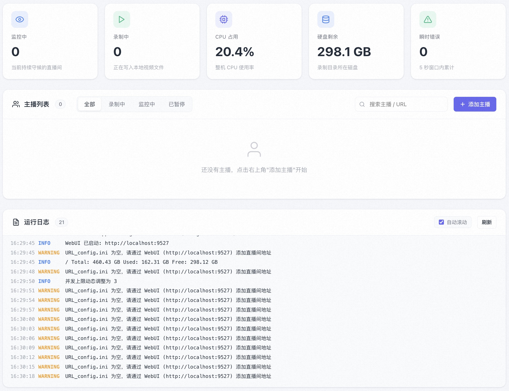

# DouyinLiveRecorder-UI

抖音与小红书直播自动录制工具（基于 [ihmily/DouyinLiveRecorder](https://github.com/ihmily/DouyinLiveRecorder) 精简改造）：轮询主播开播状态、调用 FFmpeg 录制原画直播流，自带 Web 管理界面、花屏自动重录、抖音实时弹幕录制与全文检索定位录像。



## 功能特点

- **支持平台**：抖音直播间（长短链、抖音号、主页链接）；小红书当场直播直链与 `xhslink.com` 短链。
- **花屏自动重录**：实时监控 FFmpeg 解码/坏包日志，短时间内密集报错时自动断开重拉新分段。
- **主播改名自动同步**：自动跟随抖音主播改名，同步更新监控列表、目录名和录像文件名，并记录每位主播上次下播时间。
- **弹幕录制与视频定位**：抖音直播同步录制 `.danmaku.jsonl` 弹幕，支持在网页里搜弹幕关键词并一键跳转到对应视频时间点播放。
- **特别监控开播事件**：星标主播开播时生成标准事件，可由外部机器人（如 QQ 群录制机器人）拉取推送。

## 本地运行

需预装 `ffmpeg`。默认监听 `0.0.0.0:9527`（<http://localhost:9527>）：

```console
$ uv sync
$ uv run main.py
```

## 本机部署

| 内容 | 位置 |
| --- | --- |
| 线上代码 | `/srv/apps/douyinlive-recorder/current` → `releases/<版本>` |
| systemd 服务 | `douyinlive-status.service`（系统服务，勿在终端前台跑 `main.py`） |
| 配置、日志与弹幕索引 | `/srv/apps/douyinlive-recorder/{config,logs,data}`（发布目录内通过软链指向此处） |
| 录像保存目录 | `/srv/nas/Record` |
| 访问地址 | 外网 `dy` 子域（经 Authelia）；内网 <http://192.168.3.100:9527> |

```console
$ systemctl status douyinlive-status.service
$ journalctl -u douyinlive-status.service -n 100
```

修改后端 Python 代码后，需新建 `releases/<版本>`、切换 `current` 并重启服务才生效（趁没有重要直播时重启，见下方“坑”）。

## Web UI 与添加主播

在网页顶部点添加，或直接在 `config/URL_config.ini` 里一行写一个地址：

```text
https://live.douyin.com/745964462470
https://v.douyin.com/iQFeBnt/
https://live.douyin.com/yall1102           (链接+抖音号)
https://v.douyin.com/CeiU5cbX              (主播主页)
https://www.xiaohongshu.com/livestream/570321613446566013
http://xhslink.com/xxxxxx                  (小红书分享短链)
```

注意：**小红书只能录当前这一场直播**，下播后链接即失效，下次开播需重新填新链接，且不支持录弹幕。

## 配置（`config/config.ini`）

`config.ini` 修改后会自动热加载（并发数和根目录除外，改这几项需重启服务）。开关统一填 `是` / `否`，数字不带单位。

### TempRec 目录隔离与归档回调

- **`录制中文件放到TempRec子目录 = 是`**：正在录制的 `.ts`、`.danmaku.jsonl`、`.segments.csv` 先写在 `<平台目录>/TempRec/<主播>/`。每段转完 MP4 后，先以 `.` 开头的隐藏文件写进正式目录 `<平台目录>/<主播>/`，写完再改名成正式 `.mp4`；整场结束后弹幕和分段表也一并移过去。这样 Jellyfin 的实时监控不会被正在写入的文件反复打断。
- **`转码完成回调地址 = http://127.0.0.1:8791/file`**：每段转出 MP4 后向本机 [录播归档服务](../nas-ops/README.md) 发送 `{"path": "<原ts绝对路径>"}`，由归档服务把原始 `.ts` 移到备份盘。

### 花屏重录与断流退避

| 配置项 | 默认值 | 说明 |
| --- | --- | --- |
| `自动检测花屏并重录` | `是` | 监控 FFmpeg 坏流日志，达阈值立即中断重连 |
| `花屏检测错误阈值` / `时间窗口(秒)` | `8` / `20` | 20 秒滑动窗口内出现 8 条坏流日志即触发重录 |
| `花屏重录冷却时间(秒)` | `3` | 重录前等待秒数（连续触发会按 `3 → 10 → 30 → 120` 秒退避） |
| `花屏检测是否旁路解码验证` | `否` | 额外解码一路视频抓 `copy` 模式看不见的坏帧；每路多占 5%–15% 单核 CPU |

断流重连默认从 15 秒开始，连续断流按 `15 → 30 → 60 → 120` 秒退避，稳定录制满 300 秒后清零计数。

## 开播通知

在网页主播列表点 **☆** 设为特别监控，检测到开播后会生成 `live.started` 事件供外部通知程序拉取（当前对接 [QQ 抖音录制机器人](../nas-ops/plugins/qq-douyin-recorder-plugin/README.md)）。接口协议见 [通用通知接口 v1](docs/notifications.md)。

## 弹幕录制

依赖本机部署的伴随容器 `douyinlive-danmaku`（`/srv/apps/douyinlive-danmaku/compose.yaml`，监听 `127.0.0.1:1088`）。在 `config.ini` 开启：

```ini
是否录制弹幕 = 是
弹幕服务地址 = ws://127.0.0.1:1088
```

每场直播在视频同目录生成同名的 `.danmaku.jsonl`（同一场的所有分段共用一个弹幕文件）。格式说明与转 Bilibili XML 的脚本见 [弹幕 JSONL 格式与转换](docs/danmaku.md)。

## 弹幕检索与录像定位

点击网页顶部 **弹幕检索**（`/danmaku`）：

- 支持按弹幕内容、主播名、发言人昵称/ID、时间范围检索；首次打开自动建立 SQLite 索引（`data/danmaku/index-v1.sqlite3`），后续点 **刷新弹幕索引** 增量更新。
- 点击搜索结果旁的 **定位视频**，自动根据 `.segments.csv` 分段表算出落在哪一个 `.mp4` 分段及片内秒数，支持直接在线提前 5 秒回看或下载。

## 开发

```console
$ uv run python -m unittest discover -s tests
```

```text
main.py              启动入口与主循环
src/recorder.py      单直播间录制 worker（FFmpeg 子进程管理与转码发布）
src/danmaku.py       弹幕伴随服务 WebSocket 客户端与 JSONL 写入
src/spider.py        抖音、小红书直播接口抓取
src/stream.py        流地址提取与画质选择
src/ab_sign.py       抖音 a_bogus 签名
webui/server.py      FastAPI 后端与弹幕检索接口
webui/static/        Vue 3 前端页面
scripts/danmaku_convert.py  JSONL 弹幕转 Bilibili XML
```

## 坑

- **重启服务会留下最后一段未转码的 `.ts`**：收到停止信号时进程直接退出，正在录的最后一段不会自动转成 `.mp4`，也不会触发归档回调，会一直留在 `TempRec/`。重启后如需补转码，在线上目录执行：

  ```console
  $ cd /srv/apps/douyinlive-recorder/current
  $ .venv/bin/python -B -c "import src.config_loader as c, src.recorder as r; r.converts_mp4('<ts绝对路径>', c.Settings('config/config.ini'))"
  $ .venv/bin/python -B -c "import src.recorder as r; r.publish_sidecars('<分段模板，如 .../主播_2026-10-17_19-15-37_%03d.ts>')"
  ```

## 许可证

基于 [ihmily/DouyinLiveRecorder](https://github.com/ihmily/DouyinLiveRecorder) 修改，遵循 [MIT License](LICENSE)。
